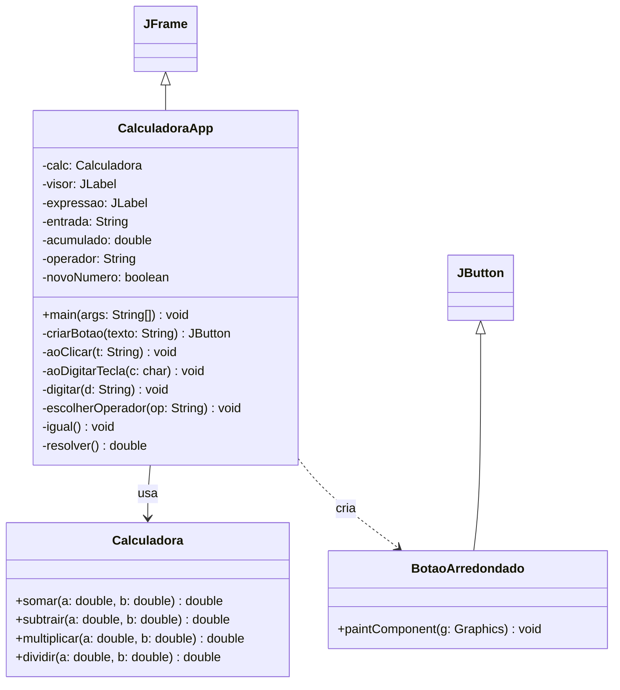

# Calculadora em Java

Calculadora de interface gráfica feita com Java Swing. O projeto contém o código-fonte, o diagrama de classes em Mermaid e um JAR executável.

## Requisitos

- JDK 21 ou mais recente para compilar o código ou gerar o aplicativo Windows.
- Java 21 ou mais recente para abrir o JAR.

## Executar o JAR

```bash
java -jar Calculadora.jar
```

## Compilar e executar pelo código-fonte

```bash
javac -encoding UTF-8 CalculadoraApp.java
java CalculadoraApp
```

## Gerar aplicativo para Windows

Em um computador com Windows e JDK 21 ou mais recente no `PATH`, execute `gerar-exe.bat`. O aplicativo será criado em `saida/Calculadora/Calculadora.exe`.

## Diagrama de classes

O arquivo [`diagrama_de_classes.mermaid`](diagrama_de_classes.mermaid) contém a versão editável. O diagrama também é renderizado pelo GitHub abaixo.


