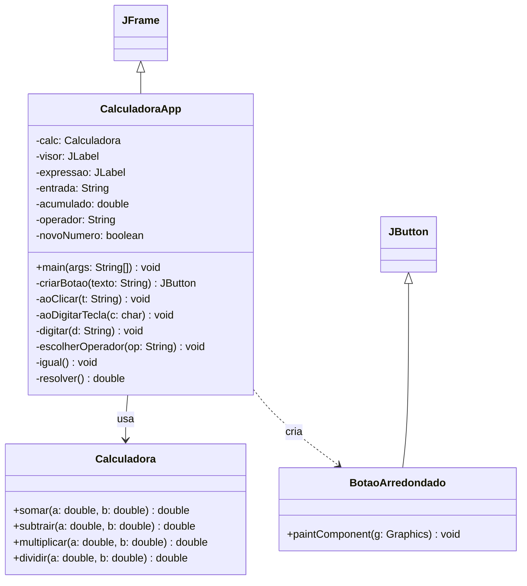

# Projeto POO - Calculadora

Calculadora de interface gráfica feita com Java Swing. O projeto inclui o código-fonte, o diagrama de classes em Mermaid e o launcher Windows `Calculadora.exe`.

## Arquivos

- `CalculadoraApp.java`: código-fonte da calculadora.
- `diagrama_de_classes.mermaid`: diagrama editável, também renderizado abaixo pelo GitHub.
- `Calculadora.exe`: launcher Windows anexado ao projeto.
- `gerar-exe.bat`: recompila o código e cria uma pasta de aplicativo Windows com runtime Java.

## Gerar o aplicativo completo para Windows

É necessário Windows x64 e JDK 21 ou mais recente no `PATH`. Execute `gerar-exe.bat`. O pacote completo será criado em `saida/Calculadora/`; mantenha juntos o executável e os arquivos dessa pasta, incluindo `runtime`.

O `Calculadora.exe` isolado é um launcher do jpackage. Para um pacote autocontido, use a pasta criada pelo script.

## Compilar e executar pelo código-fonte

```bash
javac -encoding UTF-8 CalculadoraApp.java
java CalculadoraApp
```

## Diagrama de classes


